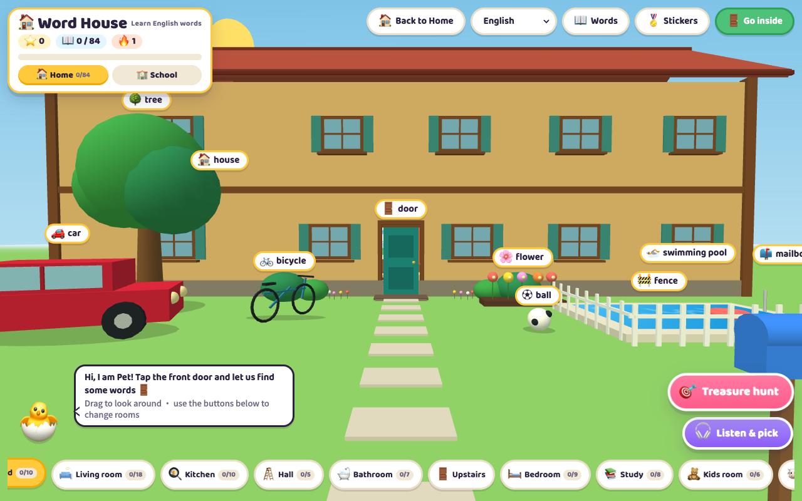
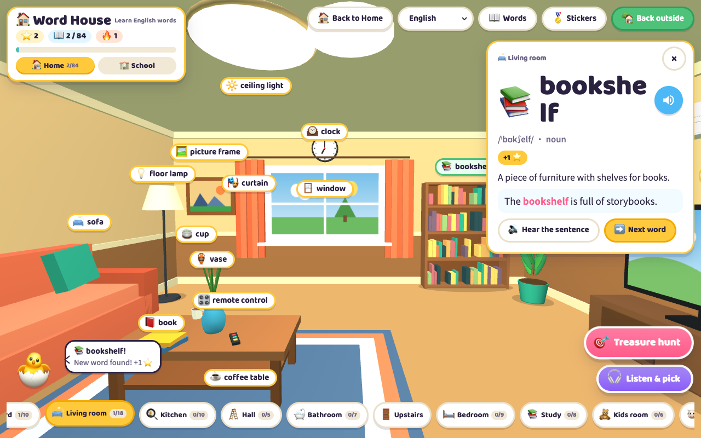
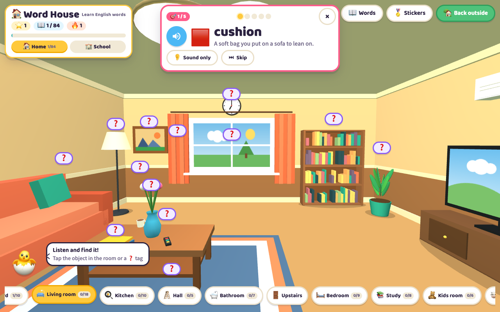
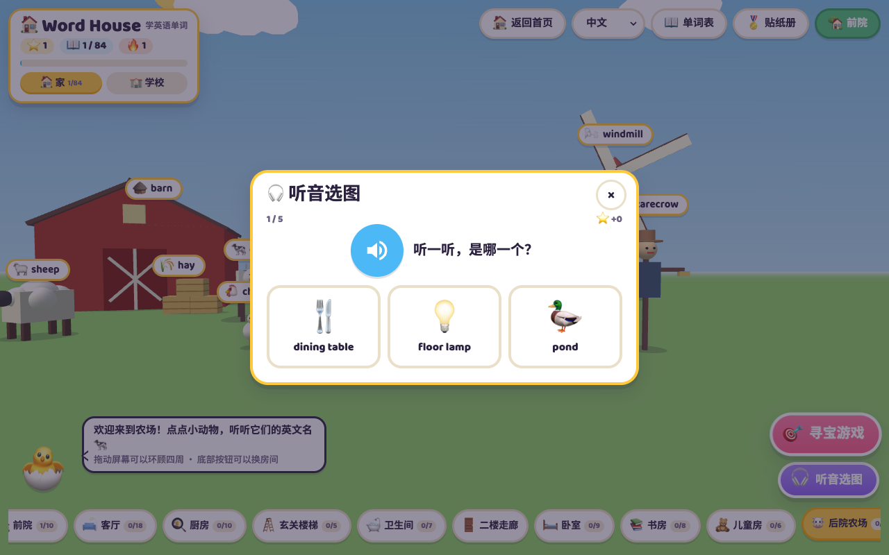
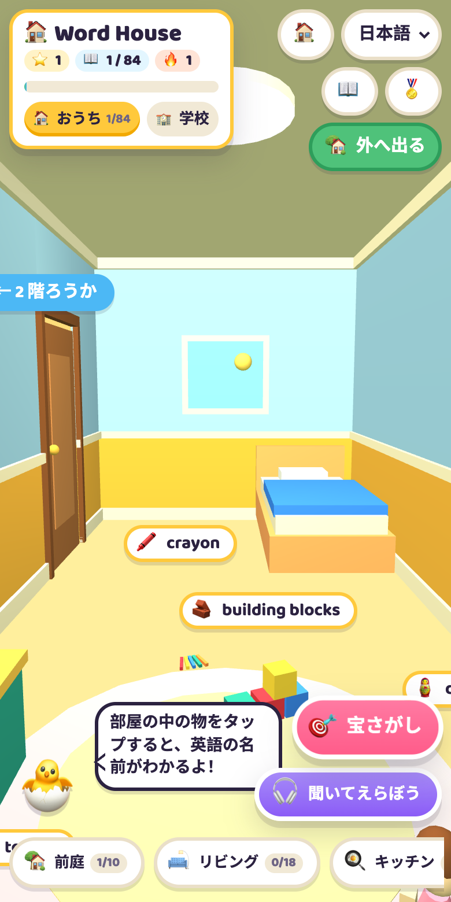

# 🏠 Word House 单词屋

[English](README.md) | **简体中文**

一栋 3D 小房子：孩子点一点身边的东西，就能学会它的英文名字。
从前院出发走过十个区域，点沙发、水壶、奶牛，听发音、看例句，再用寻宝游戏检验自己。

基于 [Three.js](https://threejs.org/) 和原生 JavaScript，没有后端，也没有前端框架：
整个应用最终打包成**一个自包含的 `index.html`**，放到任何静态托管上都能运行。

**在线体验：** <https://www.logicobs.xyz/gachaLex/zh/house>



| 单词卡 | 寻宝游戏 |
| --- | --- |
|  |  |

| 听音选图（中文界面） | 手机端（日文界面） |
| --- | --- |
|  |  |

## 功能

- **10 个区域 84 个单词**：前院、客厅、厨房、玄关楼梯、卫生间、二楼走廊、卧室、书房、儿童房和后院农场。
  所有物体都是代码建模，没有任何模型或贴图文件。
- **单词卡**：音标、词性、儿童能懂的英文释义、例句，单词和例句都能朗读（Web Speech API）。
- **寻宝游戏**：听单词，在房间里把它找出来；「只听声音」模式会把拼写藏起来。
- **听音选图**：不依赖 WebGL 的听力小测验，3D 打不开的设备也能玩。
- **星星、贴纸、连续天数**：每个房间一张贴纸，每日连续学习计数，还有彩带庆祝。
  进度只存在浏览器的 `localStorage` 里，不上传任何数据。
- **六种界面语言**：简体中文、English、日本語、한국어、ไทย、繁體中文，各自带单词释义和例句翻译。
- **触屏优先**：拖动环顾四周，按钮足够大，有手机布局，并遵循 `prefers-reduced-motion`。

## 环境要求

| 工具 | 版本 | 说明 |
| --- | --- | --- |
| [Node.js](https://nodejs.org/) | 18 及以上（推荐 20 LTS） | `.nvmrc` 固定为 20，用 nvm 的话执行 `nvm use` |
| npm | 9 及以上 | 随 Node.js 一起安装 |

查看本机版本：

```bash
node -v
```

```bash
npm -v
```

## 快速开始

```bash
git clone https://github.com/chaozhang84/word-house.git
```

```bash
cd word-house
```

```bash
npm install
```

```bash
npm run dev
```

打开 <http://localhost:3000>，`src/` 下的文件一改动页面就会自动刷新。

`npm install` 会把 gulp 装在项目本地，不需要全局安装。想直接调用 gulp 时用 `npx gulp <任务>`。

国内网络安装慢的话，可以先切换镜像源：

```bash
npm config set registry https://registry.npmmirror.com
```

## 命令

| npm 脚本 | gulp 任务 | 作用 |
| --- | --- | --- |
| `npm run dev` | `gulp serve` | 开发构建 + 本地服务器 + 监听文件 + 自动刷新 |
| `npm run build` | `gulp build` | 生产打包到 `dist/index.html`（CSS、JS 压缩） |
| `npm run build:dev` | `gulp build:dev` | 同样的产物但不压缩，方便阅读和调试 |
| `npm run preview` | `gulp preview` | 生产打包后直接起服务器，看到的就是上线后的样子 |
| `npm run clean` | `gulp clean` | 删除 `dist/` 和 `.tmp/` |

服务器默认监听 3000 端口，用 `PORT` 换一个：

```bash
PORT=8080 npm run dev
```

## 打包与部署

```bash
npm run build
```

产物只有一个文件 `dist/index.html`（约 185 kB，gzip 后 65 kB），样式、脚本和六种语言全部内联。
部署就是把这一个文件拷到 GitHub Pages、Netlify、Vercel、对象存储、nginx 等任何能放静态文件的地方，
放在任意路径下都可以。

页面运行时会从 CDN 加载两样东西：cdnjs 上的 Three.js r128，以及 Google Fonts 的两款字体。
朗读用的是访问者浏览器自带的语音。

## 构建流程

```
src/css/*.css       ── styles  ──▶ .tmp/house.css ─┐
src/js/house/*.js   ── scripts ──▶ .tmp/house.js  ─┤
src/js/boot.js      ── boot    ──▶ .tmp/boot.js   ─┼─ html ──▶ dist/index.html
src/i18n/*.json     ── i18n    ──▶ .tmp/i18n.js   ─┤
src/index.html      ───────────────────────────────┘
```

- **styles**：合并样式表，生产模式下用 clean-css 压缩。
- **scripts**：按文件名顺序拼接各个模块，外面包一层 IIFE，生产模式下用 Terser 压缩。
  这些模块共用同一个作用域，所以用数字前缀排序，而不是 ES Module。
- **boot**：处理应用启动前负责选语言的小脚本。
- **i18n**：把每种语言一个的 JSON 合并成一个 `WH_DATA` 对象。
- **html**：把 `src/index.html` 里的 `<!-- inline:… -->` 占位符替换成上面四个文件的内容。

## 目录结构

```
word-house/
├── gulpfile.js              构建流程
├── package.json
├── src/
│   ├── index.html           页面结构和内联占位符
│   ├── css/house.css        全部样式
│   ├── i18n/                每种语言一个文件：zh en ja ko th hant
│   └── js/
│       ├── boot.js          语言识别、静态文案、跳转主站的链接
│       └── house/           应用模块，按这个顺序拼接
│           ├── 00-core.js             DOM / 文案工具函数、本地存储
│           ├── 10-words.js            单词表、emoji、房间
│           ├── 20-progress.js         进度、星星、连续天数
│           ├── 30-speech.js           朗读与语音选择
│           ├── 31-sfx.js              音效（Web Audio 合成，无音频文件）
│           ├── 32-effects.js          彩带和飞星
│           ├── 40-guide.js            向导和对话气泡
│           ├── 50-ui-state.js         模式、提示、按钮状态
│           ├── 51-word-card.js        单词卡
│           ├── 52-stickers.js         贴纸册与庆祝弹窗
│           ├── 60-treasure-hunt.js    寻宝游戏
│           ├── 61-listen-quiz.js      听音选图
│           ├── 70-controls.js         按钮事件、静态文案
│           ├── 80-scene3d.js          Three.js 场景：房子、房间、相机、点选
│           └── 90-main.js             启动与无 WebGL 时的降级
├── docs/screenshots/
└── dist/                    构建产物（不进 git）
```

## 多语言

语言按这个顺序决定：URL 里的 `?lang=` 参数 → 上次在菜单里选的语言 → 浏览器语言。
可用的代码是 `zh`、`en`、`ja`、`ko`、`th`、`hant`，例如 `index.html?lang=ja`。

每个 `src/i18n/<代码>.json` 结构相同：

| 键 | 内容 |
| --- | --- |
| `htmlLang` | `<html lang>` 的值 |
| `title`、`desc` | 页面标题和 meta description |
| `text` | 写在页面结构里的文案（`index.html` 中的 `data-k="…"`） |
| `i18n` | JavaScript 里通过 `T('house.…')`、`F('house.…')` 使用的文案 |
| `words` | 每个单词 id 对应 `[释义, 例句翻译, 小贴士]`；英文为空 |

新增一种语言：复制 `en.json` 翻译一份，再在 `src/index.html` 的 `#whLang` 下拉里加一个 `<option>`。

## 新增一个单词

1. 在 `src/js/house/10-words.js` 的 `WORDS` 里加一条，并在 `EMO` 里给它配一个 emoji。
2. 在 `src/js/house/80-scene3d.js` 里建出这个物体，登记它的标签位置。
3. 在每个 `src/i18n/*.json` 的 `words` 里补上释义。

## 跳转主站的链接

单词屋是 [GachaLex](https://www.logicobs.xyz/gachaLex/zh) 的一个场景。**返回首页**按钮和**学校**标签
不在本仓库里，它们直接跳到线上站点，并把当前语言带在路径上：

| 链接 | 目标 |
| --- | --- |
| 返回首页 | `https://www.logicobs.xyz/gachaLex/{lang}` |
| 学校 | `https://www.logicobs.xyz/gachaLex/{lang}/school` |

站点地址是 `src/js/boot.js` 顶部的 `SITE` 常量。

## 浏览器支持

桌面和移动端的新版 Chrome、Edge、Safari、Firefox。3D 场景需要 WebGL；不支持时页面会降级为
单词表和听音测验。朗读效果取决于浏览器提供的语音。

调试时可以在控制台用 `window.__wordHouse()` 拿到场景 API，例如 `__wordHouse().go('kitchen')`。

## 参与贡献

欢迎提 Issue 和 Pull Request。提交前请先跑一遍 `npm run build`，并至少在一个桌面浏览器和一个手机浏览器里看过页面。

## 许可证

[MIT](LICENSE)
